<div align="center">
  
</div>

<div align="center">
  
</div>

<p align="center">
  <a href="https://linkedin.com/in/abdulmalek-alghamdi-csegr"></a>
  <a href="mailto:Abdulmalek.Alghamdi@outlook.com"></a>
  
  
</p>

<br/>

<div align="center">
  
</div>


## <samp>I · &nbsp;THE PROFILE &nbsp;<sub>نبذة</sub></samp>

<table>
<tr>
<td width="58%" valign="top">

I build products where **AI does the heavy lifting quietly** — the best technology is the one users never have to think about.

My path runs through both sides of the table: as an **IT Business Analyst** at Channels by stc I learned to turn messy business needs into precise specifications; as an **engineer** I learned to build what those specifications promise. Today, as an **Associate Product Manager at T2**, I own the space in between.

> *I translate ambiguous business needs into elegant systems — and ship them.*

</td>
<td width="42%" valign="top">

```yaml
name:      Abdulmalek Alghamdi
role:      Associate Product Manager @ T2
degree:    B.Sc. Computer Science & Engineering
school:    University of Hafr Al-Batin · 2026
standing:  Top 10% of graduates
based_in:  Saudi Arabia 🇸🇦
speaks:    [Arabic — native, English — professional]
focus:
  - Generative AI products
  - Computer vision systems
  - Enterprise architecture
  - MLOps & production AI
```

</td>
</tr>
</table>

<div dir="rtl" align="right">

> **مهندس حاسب ومدير منتجات** — أؤمن أن أفضل تقنية هي التي تحلّ المشكلة دون أن يشعر المستخدم بتعقيدها. أجمع بين فهم احتياج الأعمال وبناء حلول ذكاء اصطناعي جاهزة للإنتاج، لخدمة المنشآت في المملكة العربية السعودية.

</div>


## <samp>II · &nbsp;SIGNATURE WORK &nbsp;<sub>أبرز المشاريع</sub></samp>

<table>
<tr>
<td width="50%" valign="top">

### ◆ Humex
<sub><samp>CAPSTONE 2026 · COMPUTER VISION</samp></sub>

Real-time **occupancy intelligence**. Computer vision counts people as they move through a space, giving facility managers live numbers for retail floors, public venues and security operations.

   

<a href="https://github.com/AbdulmalekAlghamdi/Humex-2026-Capstone-Project"></a>

</td>
<td width="50%" valign="top">

### ◆ RASHID
<sub><samp>SMART GATE · 🏆 ABSHER TUWAIQ HACKATHON FINALIST</samp></sub>

A **GPT-powered access gate** for government entities. Natural-language interaction combined with secure authentication makes visitor management fast for guests and controlled for operators.

  


</td>
</tr>
<tr>
<td width="50%" valign="top">

### ◆ AOUN AI
<sub><samp>REQUEST INTELLIGENCE · STC HACKATHON STAGE 2</samp></sub>

An **AI layer for enterprise operations** that triages, prioritizes and routes incoming requests automatically, cutting the manual overhead of internal workflows.

  


</td>
<td width="50%" valign="top">

### ◇ In the Atelier
<sub><samp>WORK IN PROGRESS</samp></sub>

Currently exploring:

- **LLM-powered enterprise tools** — copilots for internal teams
- **Real-time data dashboards** — decisions at the speed of data
- **AI-driven security systems** — vision that protects

<a href="https://github.com/AbdulmalekAlghamdi?tab=repositories"></a>

</td>
</tr>
</table>


## <samp>III · &nbsp;THE JOURNEY &nbsp;<sub>المسيرة</sub></samp>

<table>
<tr>
<td width="22%" align="center" valign="top"><samp><b>NOW</b></samp></td>
<td valign="top">

**Associate Product Manager** — **T2** · Saudi Arabia
Building **RUIA**, a real-estate digital platform, from discovery to delivery. Own the roadmap, BRDs and backlog prioritization in an Agile setup, and keep engineering, design and business aligned on outcomes.

</td>
</tr>
<tr>
<td width="22%" align="center" valign="top"><samp>◆</samp></td>
<td valign="top">

**Digital Product & Growth Intern** — **Al-Rakeen** · Saudi Arabia
Shipped IoT-driven product features and integrations across connected systems and smart-device ecosystems; contributed to product strategy and technical execution.

</td>
</tr>
<tr>
<td width="22%" align="center" valign="top"><samp>◆</samp></td>
<td valign="top">

**IT Business Analyst — Co-op** — **Channels by stc** · Saudi Arabia
Translated complex business requirements into technical specifications, bridged stakeholders, developers and product teams, and supported digital-transformation initiatives.

</td>
</tr>
<tr>
<td width="22%" align="center" valign="top"><samp><b>ORIGIN</b></samp></td>
<td valign="top">

**B.Sc. Computer Science & Engineering** — **University of Hafr Al-Batin**
Graduated in the **top 10%** of the class of 2026.

</td>
</tr>
</table>


## <samp>IV · &nbsp;THE ARSENAL &nbsp;<sub>الأدوات</sub></samp>

<div align="center">

<samp>LANGUAGES</samp><br/><br/>


<br/><br/><samp>FRAMEWORKS</samp><br/><br/>


<br/><br/><samp>AI & DATA</samp><br/><br/>


<br/><br/><samp>DATA STORES</samp><br/><br/>


<br/><br/><samp>PRODUCT & DELIVERY</samp><br/><br/>


</div>


## <samp>V · &nbsp;DISTINCTIONS &nbsp;<sub>الشهادات والإنجازات</sub></samp>

<div align="center">

| | Distinction | Awarded by |
|:-:|:--|:--|
| 🎓 | **Top 10% of Graduates** — Computer Science & Engineering | University of Hafr Al-Batin |
| 🏆 | **Hackathon Finalist** — RASHID | Absher Tuwaiq |
| 🏆 | **Stage 2 Qualifier** — AOUN AI | Channels by stc |
| ◆ | **Certified AI Specialist** | SDAIA & KAUST |
| ◆ | **AI Product Manager Nanodegree** | Udacity |
| ◆ | **Java Web Developer Nanodegree** | Udacity |

</div>


## <samp>VI · &nbsp;IN NUMBERS &nbsp;<sub>بالأرقام</sub></samp>

<div align="center">
  
  
</div>

<div align="center">
  
</div>

<div align="center">
  <picture>
    <source media="(prefers-color-scheme: dark)" srcset="https://raw.githubusercontent.com/AbdulmalekAlghamdi/AbdulmalekAlghamdi/output/github-contribution-grid-snake-dark.svg"/>
    
  </picture>
</div>


<div align="center">

### <samp>LET'S BUILD SOMETHING THAT MATTERS</samp>

<sub>Open to conversations on AI products, collaboration, and roles across MENA.</sub>
<br/><sub dir="rtl">يسعدني التواصل حول مشاريع الذكاء الاصطناعي وفرص التعاون</sub>

<br/>

<a href="https://linkedin.com/in/abdulmalek-alghamdi-csegr"></a>
<a href="mailto:Abdulmalek.Alghamdi@outlook.com"></a>
<a href="https://github.com/AbdulmalekAlghamdi"></a>

<br/><br/>

<i>"The best way to predict the future is to invent it."</i> — Alan Kay

<sub><samp>CRAFTED IN SAUDI ARABIA 🇸🇦</samp></sub>

</div>
